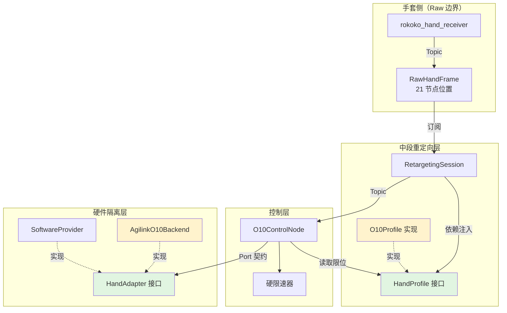

# 换手适配器架构设计方案

> 票据 07 完整设计产出 · 2026-01-15
>
> **目标**：基于业界调研（7.1）与约束盘点（7.2），设计一套模块边界与接口契约，使更换灵巧手时的修改范围最小化。

---

## 执行摘要

**核心策略**：将 O10 专属的三处硬绑定（关节契约、模型资产、硬件后端）收拢为可替换的适配层，上游重定向与控制节点代码保持不变。

**换手工作量承诺**：

1. ✅ **零修改**：`hand_retargeting_node`、`omnihand_o10_control_node` 的业务逻辑代码
2. ✅ **零修改**：中段算法（IK、滤波、stale 恢复）
3. ✅ **零修改**：控制安全机制（硬限速、锁存故障、clear_fault）
4. 🔄 **新增替换**：提供新手的 `HandProfile` + `HandAdapter` 实现
5. 🔄 **配置文件更新**：启动脚本、launchpad YAML 中的手侧参数
6. 🔄 **门禁同步**：修订 A11/A20/A25 门禁以允许新手包存在

---

## 一、模块边界设计

### 1.1 四层架构

```
┌─────────────────────────────────────────────────────────────┐
│  Rokoko 手套侧（Raw 边界）                                    │
│  ├─ rokoko_hand_receiver_node/                              │
│  └─ RawHandFrame（21 节点位置，手无关）                       │
└─────────────────────────────────────────────────────────────┘
                           ↓ Topic: /rokoko/{side}/raw_hand
┌─────────────────────────────────────────────────────────────┐
│  中段重定向层（手侧适配点）                                   │
│  ├─ hand_retargeting_node/application/session.py            │
│  │   ├─ 人体侧管线（坐标构造、长度估计）【继承，不改】         │
│  │   ├─ 机器人侧管线（IK、滤波、stale）【继承，不改】          │
│  │   └─ ⚙️ 依赖注入点：                                      │
│  │       ├─ RobotHandGeometry（从 HandProfile 获取）        │
│  │       ├─ CouplingModel（从 HandProfile 获取）            │
│  │       └─ FingerKinematicsPort（从 HandProfile 获取）     │
│  └─ 🔄 HandProfile（新增抽象层）                             │
│       ├─ 关节契约（名称、维度、限位）                          │
│       ├─ 模型几何（指根、链长、方向映射）                      │
│       ├─ 耦合模型（主动→被动关节的派生规则）                   │
│       └─ FK/IK 适配器（Pinocchio/MuJoCo 后端）                │
└─────────────────────────────────────────────────────────────┘
                           ↓ Topic: /{hand_id}_control/{side}/command
┌─────────────────────────────────────────────────────────────┐
│  控制层（安全守门员）                                         │
│  ├─ omnihand_o10_control_node/                              │
│  │   ├─ 软目标复核（name/限位/有限性）【继承，依赖注入限位】   │
│  │   ├─ 硬限速器（反馈初始化、时间额度）【继承，不改】          │
│  │   └─ 状态机（使能/暂停/锁存）【继承，不改】                 │
│  └─ 🔄 依赖：从 HandProfile 获取关节名与限位                  │
└─────────────────────────────────────────────────────────────┘
                           ↓ Service/Topic: read/write/query
┌─────────────────────────────────────────────────────────────┐
│  硬件隔离层（厂商 SDK 屏蔽）                                  │
│  ├─ 🔄 HandAdapter（新增抽象层）                             │
│  │   ├─ send_command(JointTarget) -> Response               │
│  │   ├─ read_feedback() -> JointFeedback                    │
│  │   ├─ query_errors() -> JointError                        │
│  │   └─ read_active_joints() -> JointFeedback（无动作新读）  │
│  └─ 具体实现：                                                │
│      ├─ AgilinkO10Backend（O10 当前实现）                    │
│      ├─ SoftwareProviderBackend（测试 mock）                 │
│      └─ 🆕 NewHandBackend（新手实现）                        │
└─────────────────────────────────────────────────────────────┘
```

### 1.2 关键边界约定

| 边界                                  | 约束来源           | 换手时的稳定性                                          |
| ------------------------------------- | ------------------ | ------------------------------------------------------- |
| **Raw 边界**（手套 → 中段）    | A05 + Spec D3/D6   | **不动**：换手不换手套时此边界原样保留            |
| **中段 → 控制**（软目标 wire） | A06 + Spec D32     | **参数化**：topic 名、维度由 HandProfile 提供     |
| **控制 → 硬件**（Port 契约）   | ARCH Port 表 + D54 | **抽象接口**：JointTarget/Feedback/Error 签名不变 |

---

## 二、HandProfile 接口设计

### 2.1 职责定义

`HandProfile` 是**一只灵巧手的静态描述与几何模型提供者**，职责：

1. **关节契约**：提供主动关节名称、维度、限位（取代 `joints.py`）
2. **模型几何**：提供 URDF/MJCF 资产路径、指根、链长、方向映射（取代 `omnihand_o10_model`）
3. **耦合规则**：提供主动→被动关节的派生映射（取代 `coupling.py` 中的多项式数据）
4. **FK/IK 后端**：提供 Pinocchio Model 与雅可比计算器（取代硬编码的 Pinocchio 加载）

### 2.2 接口签名草案

```python
from dataclasses import dataclass
from pathlib import Path
import numpy as np
from abc import ABC, abstractmethod

@dataclass(frozen=True)
class JointContract:
    """单侧关节契约：名称、维度、限位"""
    names: tuple[str, ...]           # 主动关节名称（如 ("thumb_roll", "thumb_abad", ...)）
    lower_limits: np.ndarray         # 下限（弧度/米）
    upper_limits: np.ndarray         # 上限
  
    @property
    def dimension(self) -> int:
        return len(self.names)


@dataclass(frozen=True)
class HandGeometry:
    """单侧手几何参数"""
    palm_frame_name: str                      # 规范掌坐标系名（如 "R_palm"）
    finger_roots: tuple[np.ndarray, ...]      # 五指根部位置（掌坐标系下）
    finger_chain_lengths: tuple[float, ...]   # 五指完整链长
    direction_mapping_matrix: np.ndarray      # 3×3 方向映射矩阵 A_s


class CouplingModel(ABC):
    """主动→被动关节的耦合派生规则"""
  
    @abstractmethod
    def compute_passive(self, active_joints: np.ndarray) -> np.ndarray:
        """从 N 维主动关节计算 M 维被动关节"""
        pass
  
    @abstractmethod
    def coupling_jacobian(self, active_joints: np.ndarray) -> np.ndarray:
        """耦合雅可比矩阵 ∂passive/∂active（M×N）"""
        pass


class FingerKinematicsPort(ABC):
    """FK/IK 计算端口"""
  
    @abstractmethod
    def forward_kinematics(self, full_joint_config: np.ndarray, tip_link: str) -> np.ndarray:
        """返回指尖在掌坐标系下的 3D 位置"""
        pass
  
    @abstractmethod
    def translation_jacobian(self, full_joint_config: np.ndarray, tip_link: str) -> np.ndarray:
        """返回 3×(N+M) 平移雅可比"""
        pass


class HandProfile(ABC):
    """灵巧手的完整静态描述"""
  
    @property
    @abstractmethod
    def hand_id(self) -> str:
        """手的唯一标识符（用于 topic 命名等）"""
        pass
  
    @abstractmethod
    def joint_contract(self, side: str) -> JointContract:
        """获取单侧关节契约"""
        pass
  
    @abstractmethod
    def geometry(self, side: str) -> HandGeometry:
        """获取单侧几何参数"""
        pass
  
    @abstractmethod
    def coupling_model(self, side: str) -> CouplingModel:
        """获取单侧耦合模型"""
        pass
  
    @abstractmethod
    def kinematics_port(self, side: str) -> FingerKinematicsPort:
        """获取单侧 FK/IK 端口"""
        pass
  
    @abstractmethod
    def model_asset_paths(self, side: str) -> dict[str, Path]:
        """返回 {"urdf": Path, "mjcf": Path, "provenance": Path}"""
        pass
```

### 2.3 通用实现（数据驱动）

**核心思想**：HandProfile 是**通用类，从配置文件读取数据**，换手只需修改配置文件的字段值。

```python
class ConfigDrivenHandProfile(HandProfile):
    """数据驱动的通用 HandProfile，所有参数从 YAML 配置加载
    
    换手 = 切换配置文件，代码零修改
    """
    
    def __init__(self, config_path: str):
        """从 YAML 配置文件加载手的所有参数"""
        import yaml
        with open(config_path, 'r') as f:
            self.config = yaml.safe_load(f)
        
        # 验证必需字段
        required = ["hand_id", "joints", "geometry", "model_assets"]
        for field in required:
            if field not in self.config:
                raise ValueError(f"Config missing required field: {field}")
    
    @property
    def hand_id(self) -> str:
        return self.config["hand_id"]
    
    def joint_contract(self, side: str) -> JointContract:
        joints_cfg = self.config["joints"]
        names = tuple(joints_cfg["names"])
        lower = np.array(joints_cfg[side]["lower_limits"])
        upper = np.array(joints_cfg[side]["upper_limits"])
        
        if len(names) != len(lower) or len(names) != len(upper):
            raise ValueError(f"Joint names/limits dimension mismatch for {side}")
        
        return JointContract(names=names, lower_limits=lower, upper_limits=upper)
    
    def geometry(self, side: str) -> HandGeometry:
        geom_cfg = self.config["geometry"][side]
        
        return HandGeometry(
            palm_frame_name=geom_cfg["palm_frame"],
            finger_roots=tuple(np.array(root) for root in geom_cfg["finger_roots"]),
            finger_chain_lengths=tuple(geom_cfg["chain_lengths"]),
            direction_mapping_matrix=np.array(geom_cfg["direction_mapping"]),
        )
    
    def coupling_model(self, side: str) -> CouplingModel:
        mjcf_path = self.config["model_assets"].get("mjcf")
        
        if mjcf_path is None:
            # 无被动关节，返回恒等映射
            return IdentityCouplingModel()
        else:
            # 从 MJCF 加载耦合多项式
            from hand_retargeting.core.coupling import MjcfCouplingModel
            return MjcfCouplingModel.from_file(mjcf_path, side)
    
    def kinematics_port(self, side: str) -> FingerKinematicsPort:
        urdf_path = self.config["model_assets"]["urdf"][side]
        
        # 使用 Pinocchio 后端加载 URDF
        from hand_retargeting.adapters.pinocchio import PinocchioKinematics
        return PinocchioKinematics.from_urdf(urdf_path)
    
    def model_asset_paths(self, side: str) -> dict[str, Path]:
        assets = self.config["model_assets"]
        return {
            "urdf": Path(assets["urdf"][side]),
            "mjcf": Path(assets["mjcf"]) if assets.get("mjcf") else None,
            "provenance": Path(assets["provenance"]),
        }


class IdentityCouplingModel(CouplingModel):
    """无被动关节的恒等耦合（主动关节 = 完整状态）"""
    
    def compute_passive(self, active_joints: np.ndarray) -> np.ndarray:
        return np.array([])  # 无被动关节
    
    def coupling_jacobian(self, active_joints: np.ndarray) -> np.ndarray:
        return np.zeros((0, len(active_joints)))  # 0×N 空矩阵
```

### 2.4 配置文件示例

#### O10 配置：`config/o10_hand.yaml`

```yaml
hand_id: o10

joints:
  names:
    - thumb_roll
    - thumb_abad
    - thumb_mcp
    - index_abad
    - index_pip
    - middle_pip
    - ring_abad
    - ring_pip
    - pinky_abad
    - pinky_pip
  
  right:
    lower_limits: [-0.0297, -1.6424, 0.0, -0.1641, 0.0, 0.0, 0.0, 0.0, 0.0, 0.0]
    upper_limits: [1.1214, 0.0454, 0.8416, 0.0, 1.4835, 1.4835, 0.1693, 1.4835, 0.1850, 1.4835]
  
  left:
    lower_limits: [-1.1214, -0.0454, -0.8416, 0.0, 0.0, 0.0, -0.1693, 0.0, -0.1850, 0.0]
    upper_limits: [0.0297, 1.6424, 0.0, 0.1641, 1.4835, 1.4835, 0.0, 1.4835, 0.0, 1.4835]

geometry:
  right:
    palm_frame: R_palm
    finger_roots:
      - [0.033, -0.011, 0.009]   # thumb
      - [0.085, 0.003, 0.025]    # index
      - [0.092, 0.003, 0.003]    # middle
      - [0.086, 0.003, -0.019]   # ring
      - [0.073, 0.003, -0.037]   # pinky
    chain_lengths: [0.087, 0.098, 0.103, 0.095, 0.082]
    direction_mapping:
      - [1.0, 0.0, 0.0]
      - [0.0, 0.0, -1.0]
      - [0.0, 1.0, 0.0]
  
  left:
    palm_frame: L_palm
    finger_roots:
      - [-0.033, -0.011, 0.009]
      - [-0.085, 0.003, 0.025]
      - [-0.092, 0.003, 0.003]
      - [-0.086, 0.003, -0.019]
      - [-0.073, 0.003, -0.037]
    chain_lengths: [0.087, 0.098, 0.103, 0.095, 0.082]
    direction_mapping:
      - [-1.0, 0.0, 0.0]
      - [0.0, 0.0, -1.0]
      - [0.0, -1.0, 0.0]

model_assets:
  urdf:
    right: omnihand_o10_model/urdf/right_hand.urdf
    left: omnihand_o10_model/urdf/left_hand.urdf
  mjcf: omnihand_o10_model/mjcf/couplings.xml  # 6 个被动关节的耦合多项式
  provenance: omnihand_o10_model/provenance.json

control:
  max_joint_rates: [3.0, 3.0, 3.0, 3.0, 3.0, 3.0, 3.0, 3.0, 3.0, 3.0]
  stale_timeout_sec: 2.0

hardware:
  backend_class: omnihand_o10_hardware_adapter.AgilinkO10Backend
  transport: hcan
  device_id: 1
  canfd_device_id: 0
```

#### Linker L20 配置：`config/linker_l20_hand.yaml`

```yaml
hand_id: linker_l20

joints:
  names:
    - thumb_cmc_ab
    - thumb_cmc_flex
    - thumb_mcp
    - thumb_ip
    - thumb_tip
    - index_mcp_ab
    - index_mcp_flex
    - index_pip
    - index_dip
    # ... 共 22 个关节
  
  right:
    lower_limits: [-0.5, -0.2, 0.0, 0.0, 0.0, -0.3, 0.0, 0.0, 0.0, ...]  # 22 维
    upper_limits: [0.5, 1.0, 1.5, 1.5, 1.5, 0.3, 1.5, 1.5, 1.5, ...]
  
  left:
    lower_limits: [...]
    upper_limits: [...]

geometry:
  right:
    palm_frame: l20_r_palm
    finger_roots:
      - [0.030, -0.020, 0.010]
      - [0.080, 0.000, 0.020]
      - [0.090, 0.000, 0.000]
      - [0.080, 0.000, -0.020]
      - [0.060, 0.000, -0.040]
    chain_lengths: [0.095, 0.110, 0.115, 0.105, 0.090]
    direction_mapping:
      - [1.0, 0.0, 0.0]
      - [0.0, 0.0, -1.0]
      - [0.0, 1.0, 0.0]
  
  left:
    palm_frame: l20_l_palm
    # ...

model_assets:
  urdf:
    right: linker_l20_model/urdf/right_hand.urdf
    left: linker_l20_model/urdf/left_hand.urdf
  mjcf: null  # L20 无被动关节
  provenance: linker_l20_model/provenance.json

control:
  max_joint_rates: [2.0, 2.0, 2.0, 2.0, 2.0, 3.0, 3.0, 3.0, 3.0, ...]  # 22 维

hardware:
  backend_class: linker_l20_hardware_adapter.LinkerL20Backend
  transport: can
  can_interface: can0
  device_id: 1
```

### 2.5 使用方式

```python
# 加载 O10
o10_profile = ConfigDrivenHandProfile("config/o10_hand.yaml")
print(o10_profile.hand_id)  # "o10"
print(o10_profile.joint_contract("right").dimension)  # 10

# 加载 L20
l20_profile = ConfigDrivenHandProfile("config/linker_l20_hand.yaml")
print(l20_profile.hand_id)  # "linker_l20"
print(l20_profile.joint_contract("right").dimension)  # 22

# 注入到 RetargetingSession
session = RetargetingSession(
    side="right",
    config=retargeting_config,
    hand_profile=o10_profile,  # 或 l20_profile
)
```

**换手 = 切换配置文件路径，HandProfile 类代码零修改。**

---

## 三、HandAdapter 接口设计

### 3.1 职责定义

`HandAdapter` 是**硬件后端的抽象层**，职责：

1. **命令发送**：接收 `JointTarget`（主动关节位置命令），返回成功/失败
2. **反馈读取**：返回 `JointFeedback`（主动关节当前状态）
3. **错误查询**：主动轮询设备错误位，返回 `JointError`
4. **无动作新读取**：提供控制层初始化硬限速器的独立读取路径

### 3.2 接口签名（当前已有，保持不变）

现有 `backends.py` 中的 `AgilinkO10Backend` 与 `BlockedExternalBackend` 已经定义了清晰的接口契约：

```python
class HandAdapter(ABC):
    """硬件后端抽象层（现有代码已实现此接口形状）"""
  
    @abstractmethod
    def send_command(self, command: JointTarget) -> HardwareResponse[None]:
        pass
  
    @abstractmethod
    def read_feedback(self) -> HardwareResponse[JointFeedback]:
        pass
  
    @abstractmethod
    def query_errors(self) -> HardwareResponse[JointError]:
        pass
  
    @abstractmethod
    def read_active_joints(self) -> HardwareResponse[JointFeedback]:
        """无动作独立读取（Spec D39：初始化硬限速器前提）"""
        pass
```

**现状评估**：`AgilinkO10Backend` 与 `BlockedExternalBackend` 已经是良好的适配器实现示例，接口形状**无需修改**，新手只需实现同样的方法。

---

## 四、中段去耦方案

### 4.1 当前耦合点清单（来自票据 01 + 7.2）

| 位置                   | 耦合内容                                                   | 成文状态                                                | 处理方案                                                                          |
| ---------------------- | ---------------------------------------------------------- | ------------------------------------------------------- | --------------------------------------------------------------------------------- |
| `contracts.py:12`    | `NODE_SUFFIXES` 21 节点镜像                              | **无授权**（ownership 表锁定单一 owner=receiver） | ✅**删除**：中段直接读 `RawHandFrame.node_names` 字段                     |
| `session.py:12`      | `from omnihand_o10_contracts import Side`                | O10 专属导入                                            | ✅**泛化**：`Side` 移入通用 contracts                                     |
| `session.py:12`      | `from omnihand_o10_contracts.joints import JOINT_LIMITS` | O10 专属限位                                            | ✅**依赖注入**：`RetargetingSession.__init__` 接收 `JointContract` 参数 |
| `session.py:14`      | `from omnihand_o10_model.contract import tip_link`       | O10 专属模型                                            | ✅**依赖注入**：通过 `HandProfile` 提供                                   |
| `session.py:198-221` | `_apply_thumb_adjustments`                               | **无成文依据**（票据 7.2 §D4）                   | ⚠️**配置化**：移入 `RetargetingConfig`，作为可选的 per-finger 调整钩子  |

### 4.2 依赖注入重构

**修改前**（`session.py:79-96`）：

```python
class RetargetingSession:
    def __init__(
        self,
        side: Side | str,
        config: RetargetingConfig,
        robot_geometry: RobotHandGeometry,  # ❌ 硬编码从 o10_model 计算
        *,
        coupling: CouplingModel | None = None,  # ❌ 硬编码 O10 多项式
        kinematics=None,  # ❌ 类型未明确
        optimizer: FingerOptimizerPort | None = None,
        clock=time.perf_counter,
    ) -> None:
        # ...
        self._last_valid = [None] * 5  # ❌ 硬编码五指
```

**修改后**：

```python
class RetargetingSession:
    def __init__(
        self,
        side: Side | str,
        config: RetargetingConfig,
        hand_profile: HandProfile,  # ✅ 注入 HandProfile
        *,
        optimizer: FingerOptimizerPort | None = None,
        clock=time.perf_counter,
    ) -> None:
        self.side = Side.from_value(side)
        self.config = config
        self.hand_profile = hand_profile
      
        # ✅ 从 HandProfile 获取
        self.joint_contract = hand_profile.joint_contract(side)
        self.geometry = hand_profile.geometry(side)
        self.coupling = hand_profile.coupling_model(side)
        self.kinematics = hand_profile.kinematics_port(side)
      
        self.optimizer = optimizer
        self._clock = clock
      
        # ✅ 动态维度
        finger_count = 5  # 暂时保持五指假设，未来可参数化
        self._last_valid = [None] * finger_count
        self._has_valid = [False] * finger_count
        # ...
```

### 4.3 中段"零 O10 痕迹"验证清单

修改后的 `hand_retargeting_node` 应满足：

- ✅ 不再 `import omnihand_o10_contracts`
- ✅ 不再 `import omnihand_o10_model`
- ✅ 不再硬编码 10 维、五指数量
- ✅ 所有手侧参数通过 `HandProfile` 注入
- ✅ 21 节点镜像删除，直接读 `RawHandFrame.node_names`

---

## 五、配置收口方案

### 5.1 当前配置散落点（来自票据 7.2 §X4）

| 位置                                  | 内容                                    | 问题     |
| ------------------------------------- | --------------------------------------- | -------- |
| `start_omnihand_control.sh:33`      | UDP 14043                               | 硬编码   |
| `start_omnihand_control.sh:222`     | `lsusb a8fa:8598`                     | 硬编码   |
| `start_omnihand_control.sh:311-321` | `hand_device_id`、`canfd_device_id` | 硬编码   |
| `start_omnihand_control.sh:338`     | `max_joint_rates`（10 维字面量）      | 硬编码   |
| `launchpad/*.yaml`                  | 同上参数重复                            | 三处复制 |

### 5.2 配置收口策略

**方案 A（推荐）**：统一配置文件 `config/{hand_id}_params.yaml`

```yaml
# config/o10_params.yaml
hand_profile:
  hand_id: o10
  profile_class: omnihand_o10_profile.OmniHandO10Profile

hardware:
  transport: hcan
  hand_device_id: 1
  canfd_device_id: 0
  canfd_channel_id: 0
  usb_vid_pid: "a8fa:8598"  # 预检用

control:
  max_joint_rates: [3.0, 3.0, 3.0, 3.0, 3.0, 3.0, 3.0, 3.0, 3.0, 3.0]
  stale_timeout_sec: 2.0
  # ... 其他 RetargetingConfig 参数

glove:
  udp_port: 14043
  actor_index: 0
```

**启动脚本重构**：

```bash
# start_omnihand_control.sh
HAND_CONFIG="${HAND_CONFIG:-config/o10_params.yaml}"
python3 -m production_bringup.launch --config "$HAND_CONFIG"
```

### 5.3 配置验证门禁

新增 A28（配置单一来源）：

- **必需配置参数不得硬编码在启动脚本中**
- **同一参数不得在多处重复定义**
- **`test_A28_config_single_source`**：扫描 `scripts/` 与 `launchpad/`，确认设备 ID、速率等参数仅出现在 YAML 配置文件中

---

## 六、模块边界图



**图例**：

- 🟢 绿色 = 新增抽象接口
- 🟡 黄色 = O10 专属实现（换手时替换）
- ⬜ 白色 = 通用业务逻辑（换手时不动）

---

## 七、换手清单（三列清单）

### 7.1 ✅ 不改（零修改承诺）

| 模块         | 文件/包                                                       | 理由                          |
| ------------ | ------------------------------------------------------------- | ----------------------------- |
| 手套接收     | `rokoko_hand_receiver_node/`                                | Raw 边界被 A05 锁定，换手不动 |
| 中段业务逻辑 | `hand_retargeting_node/application/session.py`（算法部分）  | 依赖注入后与手解耦            |
| 控制安全机制 | `omnihand_o10_control_node/application/`（状态机/硬限速器） | 安全机制通用                  |
| 启动监控     | `production_bringup/launchpad/`（编排逻辑）                 | 工具层通用                    |
| 测试框架     | `system_tests/`、`architecture_tests/`                    | 框架本身通用                  |

### 7.2 🔄 新增替换（每换一只手）

| 类别                       | 必需产出                       | 示例（O10 → Inspire Hand）                     |
| -------------------------- | ------------------------------ | ----------------------------------------------- |
| **HandProfile 实现** | Python 模块                    | `inspire_hand_profile/inspire_profile.py`     |
| **关节契约**         | 关节名、限位数据               | 16 关节 vs 10 关节                              |
| **模型资产**         | URDF + MJCF + provenance.json  | 从 Inspire SDK 提取                             |
| **耦合模型**         | CouplingModel 实现             | 若无被动关节则返回空映射                        |
| **FK/IK 适配器**     | FingerKinematicsPort 实现      | 可复用 Pinocchio 或切换 MuJoCo                  |
| **HandAdapter 实现** | Python 模块 + SDK 集成         | `inspire_hardware_adapter/inspire_backend.py` |
| **配置文件**         | `config/inspire_params.yaml` | 设备 ID、速率、通信参数                         |

### 7.3 ⚠️ 修改（受影响需同步）

| 位置                     | 修改内容                                              | 触发条件           |
| ------------------------ | ----------------------------------------------------- | ------------------ |
| **A11 门禁**       | `test_A11_...` 允许新手 contracts 包                | 若新手单独建包     |
| **A20/A25 门禁**   | 节点/包 allowlist                                     | 若新增手侧节点     |
| **wire schema**    | `rokoko_omnihand_msgs/` 中的 `O10ControlState` 等 | 若诊断字段维度变化 |
| **Launchpad 面板** | 关节曲线数量、错误位事件                              | UI 需适配新手维度  |

---

## 八、设计决策记录

### D1：模块边界形态（解决待决策 §D1）

**决策**：HandProfile 与 HandAdapter 作为 **`teleoperation_support/` 下的独立包**，而非新增顶层节点。

**理由**：

1. CONTEXT 术语表（第 115-117 行）明确："求解、关节映射是重定向节点**内部职责**，不是独立系统节点"
2. A20/A25 门禁锁定节点 allowlist，新增节点需修订成文约束，改动面大
3. 参考 `o10_contracts`、`o10_model_assets` 模式：support 包提供能力，业务节点注入依赖

**包结构**：

```
src/teleoperation_support/
  ├─ hand_profile_interface/        # 定义 HandProfile/HandAdapter 抽象基类
  ├─ omnihand_o10_profile/          # O10 实现
  │   ├─ o10_profile.py
  │   ├─ o10_coupling.py
  │   └─ o10_kinematics.py
  └─ omnihand_o10_hardware_adapter/ # 已有，保持不变
```

### D2：软目标 wire 契约是否泛化（解决待决策 §D2）

**决策**：**保守策略** —— 不泛化，新手平行新建 topic。

**理由**：

1. Spec D32/D36 + K02 反复强调 `name` 自校验与固定顺序是控制安全核心
2. K06 明文 `position[10]`，修改维度需同步 wire schema（破坏性变更）
3. A16 门禁锁定"wire enum/字段单一来源"
4. 平行 topic 模式（如 `/inspire_control/{side}/command`）无需修改现有 wire schema，风险最小

**实施**：

- `HandProfile.hand_id` 返回 topic 命名前缀（如 "o10" / "inspire"）
- 控制节点订阅 `/{hand_id}_control/{side}/command`
- 诊断 topic 同样按 `hand_id` 命名

### D3：A11 唯一 owner 的落点（解决待决策 §D3）

**决策**：**保留包名语义** —— `omnihand_o10_contracts` 专属 O10，新手建 `{hand_name}_contracts`。

**理由**：

1. A11 门禁测试已按现包名锚定
2. 包名含 `o10` 使"这是 O10 专属契约"语义清晰
3. 新手建独立 contracts 包（如 `inspire_hand_contracts`）无歧义
4. 门禁修订：`test_A11` 改为"每手的 contracts 包必须是该手关节事实的唯一 owner"

### D4：拇指专调去留（解决待决策 §D4）

**决策**：**保留但配置化** —— 移入 `RetargetingConfig`，作为可选 per-finger 调整钩子。

**理由**：

1. 票据 01 明确"runs/ 会话验证值"，说明此调整有真机有效性证据
2. 虽无 spec 条文，但属"手特定经验补偿"（类似 LEAP `teleop` 模式的指 12/14 补偿，见 7.1 §4.4）
3. 业界先例：dex-retargeting 的 `scaling_factor`、Drake SchunkWSG 的 `pid_gains`
4. 配置化后新手可选择性使用（不强制）

**实施**：

```python
@dataclass(frozen=True)
class RetargetingConfig:
    # ... 现有字段 ...
    # 🆕 可选的 per-finger 调整（元组长度 = finger_count）
    finger_sensitivity_gains: tuple[float, ...] | None = None
    finger_fixed_values: tuple[float | None, ...] | None = None
```

### D5/D6：触觉 Port 与诊断字段（解决待决策 §D5/D6）

**决策**：

- **D5**：触觉 Port **保留为可选能力**，HandAdapter 返回 `NOT_SUPPORTED` 响应码
- **D6**：诊断消息**字段级参数化**，通过 `HandProfile` 声明

**理由**：

- "触觉只读不进安全"（K02）值得沉淀为通用原则
- 新手可能无触觉或布局完全不同，不应强制实现
- 诊断字段（残差、求解器、错误位）的维度/语义随手变化，需 Profile 声明

### D7：Launchpad 方块语义（解决待决策 §D7）

**决策**：**同构替换** —— 方块结构不变，内容由 `config/{hand_id}_params.yaml` 驱动。

**理由**：

- L-Spec 方块与业务节点一一对应（结构继承）
- hcan provider 方块改名为 "hardware provider"（中性命名）
- 10 关节曲线由前端读取 `HandProfile.joint_contract().names` 动态渲染

### D8：ARCHITECTURE.md 路径漂移修复

**决策**：**推迟到票据 10（spec review）时统一修订**。

**理由**：

- 门禁测试已正确锚定扁平化 `src/`，约束实质未变
- 票据 07-09 产出的新 spec 将取代现有 ARCH 部分条文
- 统一在票据 10 处理文档迁移，避免中途漂移

---

## 九、实施路线图（供票据 08/09 参考）

### 阶段 1：接口定义（无破坏性）

1. 新增 `hand_profile_interface` 包，定义 `HandProfile`/`HandAdapter` 抽象基类
2. 新增 `omnihand_o10_profile` 包，实现 O10 的 `HandProfile`
3. 单元测试验证 O10Profile 返回值与现有 `joints.py`/`loader.py` 一致

### 阶段 2：依赖注入重构（向后兼容）

1. `RetargetingSession.__init__` 新增 `hand_profile` 参数（保留旧参数作为 deprecated）
2. 修改 `hand_retargeting_node` 的组合根，注入 `O10Profile` 实例
3. 删除 `contracts.py` 中的 21 节点镜像
4. 集成测试验证链路零回归

### 阶段 3：配置收口（新门禁）

1. 创建 `config/o10_params.yaml`，迁移启动脚本硬编码
2. 修改 `start_omnihand_control.sh` 读取配置文件
3. 新增 A28 门禁：`test_A28_config_single_source`
4. 真机验证启动流程

### 阶段 4：门禁修订（成文同步）

1. 修订 A11 测试：允许 per-hand contracts 包
2. 修订 A20/A25：若新手需新增包，更新 allowlist
3. 更新 ARCHITECTURE.md 与 Spec 文档

### 阶段 5：第二只手验证（可选）

1. 引入第二只手（如 Inspire Hand）的 SDK 与模型
2. 实现 `inspire_hand_profile` + `inspire_hardware_adapter`
3. 端到端验证"只改少数模块"承诺

---

## 十、验收标准

| # | 标准                                                  | 验证方法                                                   |
| - | ----------------------------------------------------- | ---------------------------------------------------------- |
| 1 | `hand_retargeting_node` 不再导入 `omnihand_o10_*` | grep 源码，零命中                                          |
| 2 | 21 节点镜像删除                                       | `contracts.py` 中 `NODE_SUFFIXES` 不存在               |
| 3 | 配置单一来源                                          | A28 门禁通过                                               |
| 4 | 启动脚本零硬编码                                      | `start_omnihand_control.sh` 中设备 ID/速率由 YAML 读取   |
| 5 | 接口抽象完整                                          | `HandProfile`/`HandAdapter` 签名覆盖票据 01 全部耦合点 |
| 6 | 真机零回归                                            | 重构后 O10 真机测试全绿                                    |

---

## 附录 A：业界模式映射表

| 业界先例                                                        | 本项目对应                                |
| --------------------------------------------------------------- | ----------------------------------------- |
| ros2_control`<plugin>` + pluginlib                            | `HandProfile` 注册表 + 工厂             |
| ros2_control`HardwareInfo`                                    | `JointContract` + `HandGeometry`      |
| dex-retargeting`RetargetingConfig` YAML                       | `config/{hand_id}_params.yaml`          |
| Drake`SchunkWsgDriver` + `SchunkWsgPositionController` 分离 | `HandAdapter`（接线）+ 中段（翻译）分层 |
| robosuite`GripperModel` 子类 + 字符串工厂                     | `HandProfile` 子类 + `hand_id` 索引   |
| MoveIt`controller_list` YAML                                  | Launchpad 方块配置                        |

---

## 附录 B：与票据 7.2 约束的完整对照

| 约束清单分类             | 本设计对应                             | 继承/替换 |
| ------------------------ | -------------------------------------- | --------- |
| §3.1 必须继承清单 22 组 | 全部保留（分层/所有权/安全机制/边界）  | ✅ 继承   |
| §3.2 可取代清单 10 项   | `HandProfile` + `HandAdapter` 吸收 | ✅ 替换   |
| §3.3 待决策 D1–D8      | 本文档 §八 全部裁决                   | ✅ 已决   |
| §4 票据 01 耦合点 12 条 | §四 逐条对照处理方案                  | ✅ 覆盖   |

---

**下一步**：将本设计方案提交票据 08/09，撰写正式 spec 文档。
