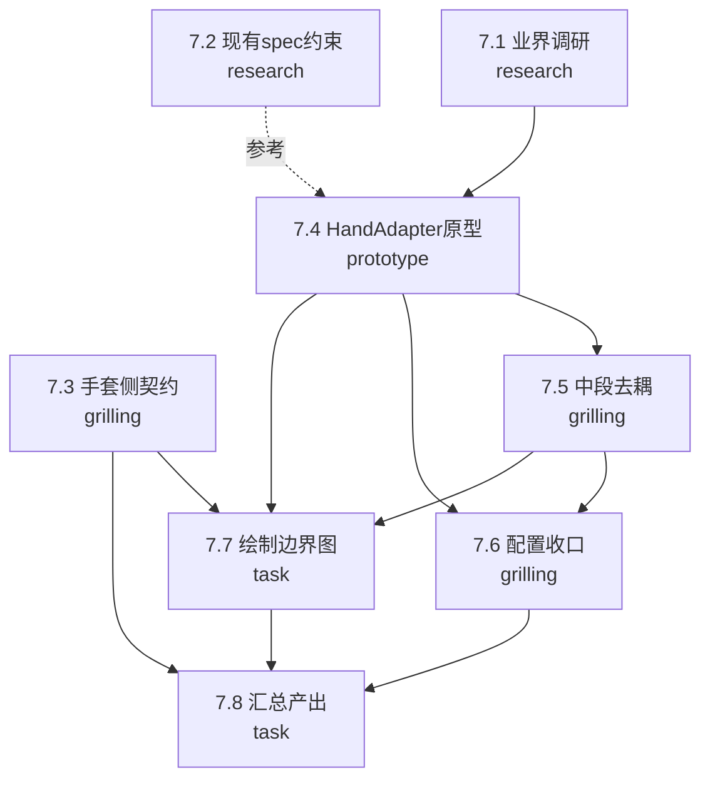

# 票据 07 拆解：架构设计协同工作指南

## 总览

票据 07（确定换手适配的模块边界与接口契约）已拆解为 **8 个子票据**，组织为一个独立的子地图：

📋 **子地图**：[hand-adapter-architecture.md](maps/hand-adapter-architecture.md)

## 拆解结构

### 🎯 核心问题映射

原票据 07 的 5 个问题对应关系：

| 原问题 | 新票据 | 类型 | 说明 |
|--------|--------|------|------|
| 问题 1：手侧适配层形状 | 7.1 + 7.4 | research + prototype | 先调研业界模式，再原型设计 |
| 问题 2：手套侧契约 | 7.3 | grilling | 独立决策点 |
| 问题 3：中段去耦 | 7.5 | grilling | 依赖 HandAdapter 接口设计 |
| 问题 4：配置收口 | 7.6 | grilling | 依赖接口设计与去耦策略 |
| 问题 5：现有 spec 继承 | 7.2 | research | 先盘点约束，各票决策时参考 |

额外增加：
- 7.7：绘制模块边界图（汇总可视化）
- 7.8：整合换手清单与接口签名（最终产出）

### 📊 依赖拓扑



### 🚀 并行工作方案

#### Wave 1（3 sessions，可同时启动）
- **Session A**：`7.1 业界手适配器调研`（research，subagent 自动）
- **Session B**：`7.2 现有 spec 约束盘点`（research，subagent 自动）
- **Session C**：`7.3 手套侧契约冻结决策`（grilling，需与你对话）

#### Wave 2（等 7.1 完成）
- **Session D**：`7.4 HandAdapter 接口原型`（prototype，依赖 7.1 调研结果）

#### Wave 3（等 7.4 完成，2 sessions 并行）
- **Session E**：`7.5 中段去耦策略`（grilling）
- **Session F**：`7.6 配置收口决策`（grilling）

#### Wave 4（等 7.3/7.4/7.5 完成）
- **Session G**：`7.7 绘制模块边界图`（task，自动）

#### Wave 5（等所有前序完成）
- **Session H**：`7.8 汇总换手清单与接口签名`（task，自动）

**预估总时长**：5 waves，关键路径约 5-6 sessions（串行部分），wall-clock 时间取决于并行度。

## 使用方式

### 方案 A：多 session 人工调度
```bash
# Terminal 1
wayfinder --ticket 7.1

# Terminal 2（同时）
wayfinder --ticket 7.2

# Terminal 3（同时）
wayfinder --ticket 7.3  # 这个需要你参与对话

# 等 7.1 完成后
# Terminal 4
wayfinder --ticket 7.4

# 依此类推...
```

### 方案 B：让 wayfinder 自动选取 frontier
```bash
wayfinder --map hand-adapter-architecture
# 自动从 frontier（7.1/7.2/7.3）中选一个未 claim 的
```

## 票据清单

| ID | 标题 | 类型 | 依赖 | 状态 |
|----|------|------|------|------|
| 7.1 | 业界手适配器设计调研 | research | 无 | open |
| 7.2 | 现有 spec 约束盘点 | research | 无 | open |
| 7.3 | 手套侧契约冻结决策 | grilling | 无 | open |
| 7.4 | HandAdapter 接口原型 | prototype | 7.1 | open |
| 7.5 | 中段去耦策略定案 | grilling | 7.4 | open |
| 7.6 | 配置单一来源收口 | grilling | 7.4, 7.5 | open |
| 7.7 | 绘制模块边界图 | task | 7.3, 7.4, 7.5 | open |
| 7.8 | 汇总换手清单与接口签名 | task | 7.3-7.7 | open |

## 关键产出

完成所有票据后，将得到：

1. **模块边界图**（7.7）：可视化的架构分层与接口
2. **换手清单**（7.8）：必改/可选改/不改的三列清单
3. **接口签名草案**（7.8）：HandAdapter、RawHandFrame、HandProfile 的完整签名
4. **配置收口方案**（7.6）：统一配置源的设计
5. **所有设计决策的文档化记录**（各票据的 resolution）

这些产出将直接支撑票据 08/09 撰写正式 spec 文档。

## 注意事项

- **HITL 票据**（7.3/7.4/7.5/7.6）必须与你对话完成，不能让 agent 自己作决定
- **Research 票据**（7.1/7.2）可通过 subagent 并行执行
- **Task 票据**（7.7/7.8）是落地执行工作，agent 可独立完成
- 每个 session 启动前会自动 claim 票据（assign 给你），避免冲突
